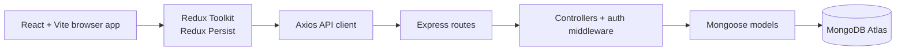
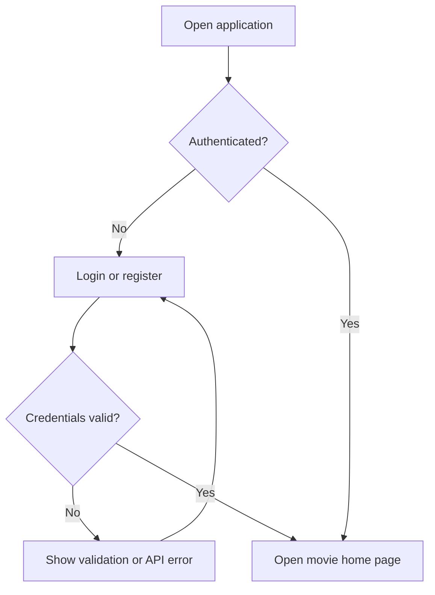

# Movie Ticket Reservation

Movie Ticket Reservation is a full-stack movie booking application built with React, Redux Toolkit, Express, and MongoDB. Users authenticate first, browse movies, choose a theatre and showtime, select available seats, complete a booking, and manage their tickets from the booking history screen.

The interface is designed around a simple cinema-booking journey while the backend keeps seat availability, booking ownership, prices, and cancellation rules as the source of truth.

## Live demo

**Live website:** `https://mtr-app-1.onrender.com`

Replace the placeholder above with the deployed frontend URL when the Render services are live.

## Demo account

Use the seeded account to enter the application:

```text
Email:    demo@movieapp.com
Password: Demo@123
```

## Features

- JWT-based registration, login, logout, and session restoration
- Protected application routes and booking endpoints
- Movie browsing with posters, hero images, ratings, genres, descriptions, and cast
- Theatre, date, format, and showtime selection
- Live seat availability for every showtime
- Persistent booking journey using Redux Persist and browser local storage
- Transactional booking creation and cancellation with MongoDB sessions
- Automatic seat release after cancellation
- Booking ownership enforcement on the backend
- Responsive ticket history and booking confirmation views
- Render-ready frontend and backend configuration

## Technology stack

### Frontend

- React 19
- Vite
- React Router
- Redux Toolkit and React Redux
- Redux Persist
- Axios
- Tailwind CSS
- Lucide React

### Backend

- Node.js with ES modules
- Express
- MongoDB and Mongoose
- JSON Web Tokens
- bcryptjs
- CORS

## Architecture



The frontend owns presentation and temporary UI state. Redux stores the booking journey and authentication state, Axios communicates with the API, and the backend validates every protected operation before changing MongoDB data.

## User flow

### Authentication flow



### Booking flow

```mermaid
flowchart LR
    Home[Browse movies] --> Movie[Open movie details]
    Movie --> Theatre[Choose theatre]
    Theatre --> Schedule[Choose date, format, and showtime]
    Schedule --> Seats[Load live seat matrix]
    Seats --> Summary[Select seats and review total]
    Summary --> Checkout[Checkout]
    Checkout --> Confirm[Create booking transaction]
    Confirm --> Ticket[Booking confirmation]
    Ticket --> History[View ticket history]
    History --> Cancel[Cancel ticket]
    Cancel --> Released[Restore seats]
```



## Project structure

```text
.
├── backend/
│   ├── src/
│   │   ├── config/          MongoDB connection
│   │   ├── controllers/     Auth, movie, theatre, showtime, booking logic
│   │   ├── middleware/      JWT, ObjectId, and error handling
│   │   ├── models/          User, Movie, Theatre, Showtime, Booking
│   │   ├── routes/          Express API route definitions
│   │   ├── utils/           Errors, async handling, and seat layouts
│   │   ├── seed.js          Idempotent demo data seeder
│   │   └── server.js        API entry point
│   └── .env.example
├── public/images/            Movie, theatre, auth, and ticket artwork
├── src/
│   ├── components/           Reusable UI components
│   ├── pages/                Application screens
│   ├── redux/
│   │   ├── api/              Axios configuration
│   │   ├── slices/           Auth, movie, schedule, seat, and booking state
│   │   └── store.js          Single Redux store and persistence
│   ├── routes/               Public and protected route configuration
│   └── main.jsx              React entry point
├── render.yaml               Render service definitions
└── package.json              Frontend scripts and dependencies
```

## Running locally

### Prerequisites

- Node.js 18 or newer
- A MongoDB Atlas database or another MongoDB deployment that supports transactions
- Git

### 1. Install frontend dependencies

From the project root:

```bash
npm install
```

Create a root `.env` file:

```env
VITE_API_URL=http://localhost:5000/api
VITE_BOOKING_FEE=20
```

Start the frontend:

```bash
npm run dev
```

The Vite app is available at `http://localhost:5173`.

### 2. Install and configure the backend

Open another terminal:

```bash
cd backend
npm install
```

Copy `backend/.env.example` to `backend/.env` and set your values:

```env
PORT=5000
MONGO_URI=mongodb+srv://<username>:<password>@<cluster-url>/<database>?retryWrites=true&w=majority
BOOKING_FEE=20
JWT_SECRET=replace-with-a-long-random-secret
JWT_EXPIRES_IN=7d
FRONTEND_URL=http://localhost:5173
```

Start the API:

```bash
npm run dev
```

The API is available at `http://localhost:5000`. Check `http://localhost:5000/health` to verify that the server is running.

### 3. Seed demo data

Run this from the `backend` directory:

```bash
npm run seed
```

The seeder creates the demo user, movies, theatres, showtimes, and a valid demo booking. It is safe to run repeatedly for local development, but it resets the seeded booking-related data.

## API overview

The backend is mounted under `/api`.

| Method | Endpoint | Purpose | Auth |
|---|---|---|---|
| POST | `/api/auth/register` | Create an account | Public |
| POST | `/api/auth/login` | Sign in and receive a JWT | Public |
| GET | `/api/auth/me` | Restore the current user | Protected |
| GET | `/api/movies` | List movies | Public |
| GET | `/api/theatres` | List theatres | Public |
| GET | `/api/showtimes` | List showtimes | Public |
| GET | `/api/showtimes/:id/seats` | Read a showtime seat matrix | Public |
| POST | `/api/bookings` | Create a booking | Protected |
| GET | `/api/bookings` | List the signed-in user's bookings | Protected |
| GET | `/api/bookings/:id` | Read one owned booking | Protected |
| PATCH | `/api/bookings/:id/cancel` | Cancel one owned booking | Protected |

Protected requests use:

```http
Authorization: &lt;JWT&gt;
```

## Booking consistency and security

- Booking creation and cancellation run inside MongoDB transactions.
- The backend checks showtime existence, seat limits, duplicate seats, and current availability.
- The final ticket price is calculated from the database, not trusted from the browser.
- Seats become occupied only when the booking transaction succeeds.
- Cancelling a confirmed booking changes its status and releases its seats atomically.
- A cancelled booking cannot be cancelled again.
- Booking ownership comes from the verified JWT and cannot be supplied by the frontend.
- Passwords are hashed with bcryptjs and are never returned in API responses.
- JWT secrets and database credentials belong only in environment variables.

MongoDB transactions require MongoDB Atlas or a replica-set deployment. A standalone MongoDB process may not support the booking transaction flow.

## Render deployment

The included `render.yaml` defines one Node web service and one static frontend service.

### Backend web service

- **Root directory:** `backend`
- **Build command:** `npm ci`
- **Start command:** `npm start`
- **Health check:** `/health`

Set these Render environment variables:

```text
MONGO_URI=<your MongoDB Atlas connection string>
JWT_SECRET=<long random secret>
JWT_EXPIRES_IN=7d
BOOKING_FEE=20
FRONTEND_URL=https://<your-frontend>.onrender.com
```

### Frontend static site

- **Build command:** `npm ci && npm run build`
- **Publish directory:** `dist`

Set:

```text
VITE_API_URL=https://<your-backend>.onrender.com/api
```

For React Router deep links, configure this rewrite in the Render static site settings:

```text
Source:      /*
Destination: /index.html
Action:      Rewrite
```

The same rewrite is already included in `render.yaml`.

After both services deploy:

1. Add the final frontend URL to the backend `FRONTEND_URL`.
2. Confirm the frontend `VITE_API_URL` points to the backend URL ending in `/api`.
3. Allow the Render backend URL in MongoDB Atlas Network Access.
4. Run `npm run seed` from the backend service shell if the production database needs demo data.
5. Test login, movie loading, seat selection, booking, ticket history, and cancellation.

Never commit `.env` files or expose MongoDB credentials and JWT secrets in frontend code. If a database password has been shared publicly, rotate it before deployment.

## Useful commands

From the project root:

```bash
npm run dev       # Start the Vite development server
npm run build     # Create a production frontend build
npm run lint      # Run frontend ESLint
npm run preview   # Preview the production build locally
```

From `backend`:

```bash
npm run dev       # Start the API with Nodemon
npm start         # Start the API normally
npm run seed      # Seed demo users and movie data
npm test          # Run backend booking tests
```
